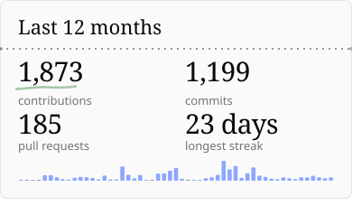
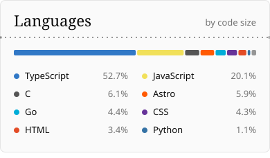

  <a href="https://www.jordannst.dev">
    <picture>
      <source media="(prefers-color-scheme: dark)" srcset="assets/readme/header-dark.svg">
      
    </picture>
  </a>

*Full-stack developer building practical software with clean interfaces and reliable foundations.*

Fourth-year CS student from Indonesia. This is where my experiments live: web apps, AI tooling, and the occasional dive into Linux internals.

#### Focus

- Web apps with React, Next.js, and Laravel, backed by Node.js and PostgreSQL
- Mobile apps with React Native
- Retrieval pipelines and AI agents for real business workflows
- Reliable systems with Go, DevOps, and cloud infrastructure

#### GitHub activity

  <picture>
    <source media="(prefers-color-scheme: dark)" srcset="assets/readme/activity-dark.svg">
    
  </picture>
  <picture>
    <source media="(prefers-color-scheme: dark)" srcset="assets/readme/languages-dark.svg">
    
  </picture>

#### Stack

`TypeScript` `Go` `C` `Python` `Next.js` `React` `React Native` `Astro` `Laravel` `Express` `PostgreSQL`

[jordannst.dev ↗](https://www.jordannst.dev) &nbsp;·&nbsp; [LinkedIn ↗](https://www.linkedin.com/in/jordannst08/) &nbsp;·&nbsp; [Email](mailto:jordannst.08@gmail.com)

<picture>
  <source media="(prefers-color-scheme: dark)" srcset="assets/readme/footer-dark.svg">
  
</picture>
